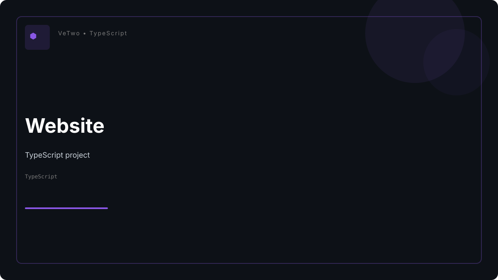
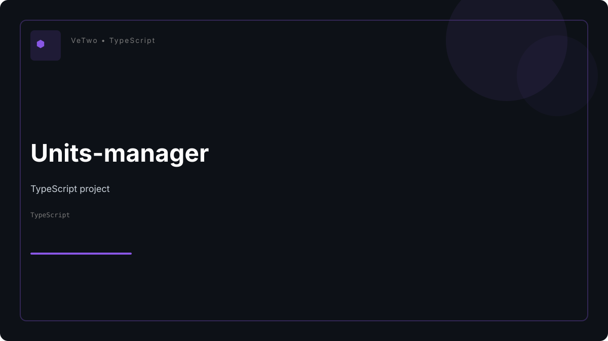
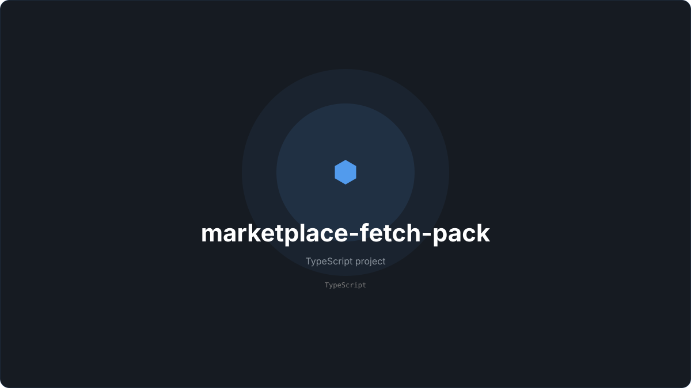
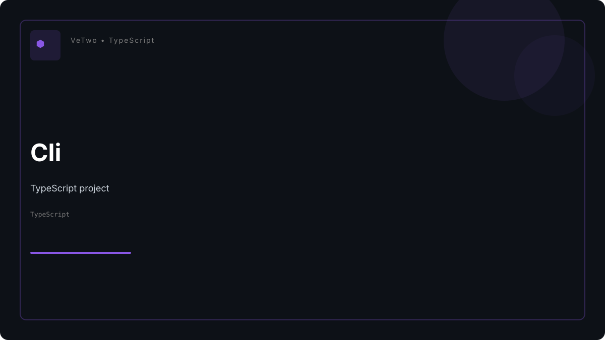
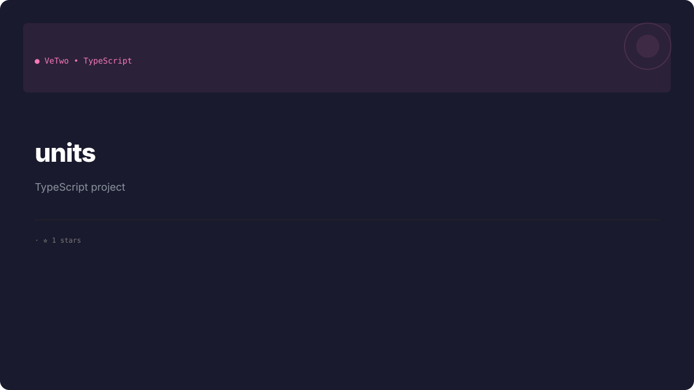
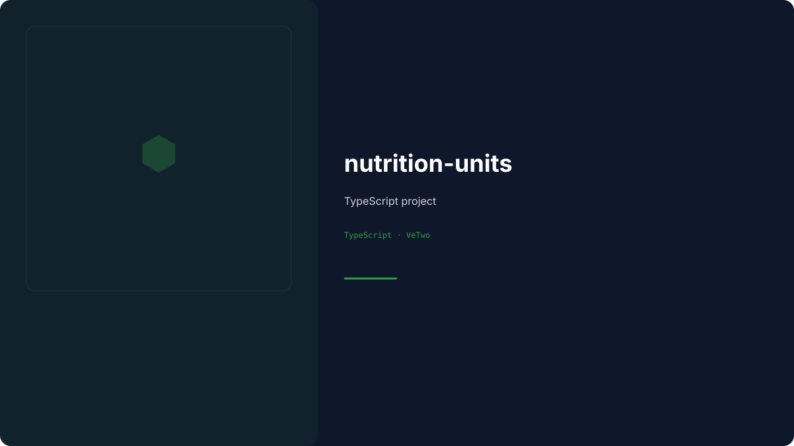
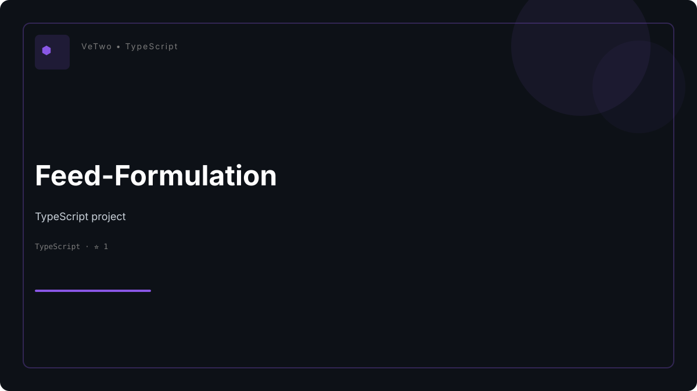

<!-- This file is generated from profile/*.md — do not edit directly. Run `pnpm readme` to regenerate. -->

  <!-- Header Banner -->
  

   
  
  <!-- Logo Mark -->
  

  <!-- Logo (مسار مباشر مضم مضمون الظهور مع إمكانية التبديل برابط Raw) -->

   
   

  ### Bridging Veterinary Clinical Precision & Modern Software Engineering

   

  <!-- Minimal & Clean Badges -->
  
  &nbsp;
  
  &nbsp;
  
  &nbsp;
  

 **Building the open-source software layer for veterinary medicine, animal nutrition systems, and IoT health monitors.**

   

<!-- Animated Typing Subtitles -->

  

---

## 🧬 Engineering the Future of VetTech

**VeTwo** is a software initiative dedicated to building the foundational digital infrastructure for veterinary medicine, animal nutrition, and IoT health monitors.

Instead of monolithic systems, we architect a **modular, high-performance ecosystem** of specialized packages—applying modern software engineering rigor to complex biological and clinical challenges.

 

### 🎯 Core Engineering Horizons

<table>
  <tr>
    <td width="50%">
      <h4>⚡ Precision Scientific Computing</h4>
      <ul>
        <li><b>Type-Safe Algorithmic Engines:</b> Zero-runtime overhead calculations for physiological & nutritional formulas.</li>
        <li><b>Dimensional Analysis Units:</b> Automated unit conversions across veterinary metric systems.</li>
      </ul>
    </td>
    <td width="50%">
      <h4>📐 Optimization & Data Science</h4>
      <ul>
        <li><b>Linear Programming Systems:</b> High-throughput feed-formulation & cost-optimization solvers.</li>
        <li><b>IoT Telemetry Pipelines:</b> Real-time environmental monitoring for livestock & poultry.</li>
      </ul>
    </td>
  </tr>
  <tr>
    <td width="50%">
      <h4>🛠 Developer Tooling & SDKs</h4>
      <ul>
        <li><b>Modular Package Architecture:</b> Focused, decoupled TypeScript/Rust libraries designed for maximum reusability.</li>
        <li><b>Standardized APIs:</b> Unified REST & WebSocket protocols for animal health data.</li>
      </ul>
    </td>
    <td width="50%">
      <h4>📖 Infrastructure & Governance</h4>
      <ul>
        <li><b>Enterprise Docs Engine:</b> High-availability, interactive documentation portals.</li>
        <li><b>Open Source Governance:</b> Strict security pipelines, automated CI/CD, and transparent contribution guidelines.</li>
      </ul>
    </td>
  </tr>
</table>

 

> 💡 *Built primarily with **TypeScript & Rust** — adhering to UNIX philosophy: small, single-purpose software primitives designed to do one thing with medical-grade precision.*

---

## GitHub Analytics & Ecosystem Activity

 
<!-- Contribution Snake Grid -->
<h3><b><samp>Contribution Matrix</samp></b></h3>

<picture>
  <source
    media="(prefers-color-scheme: dark)"
    srcset="./assets/github/github-contribution-grid-snake-dark.svg"
  />
  <source
    media="(prefers-color-scheme: light)"
    srcset="./assets/github/github-contribution-grid-snake.svg"
  />
  
</picture>

 
 

<!-- Stats Cards Grid (Side-by-Side) -->
<a href="https://github.com/VeTwo-dev">
  
  &nbsp;
  
</a>

 
 

<!-- Streak Stats Card -->

 
 

<!-- Activity Graph -->

---

## 🛠 Technology Landscape & Core Architecture

The engineering ecosystem behind <b>VeTwo</b> is powered by a high-performance, type-safe, and resilient stack engineered for medical-grade precision and IoT edge computing.

 

<!-- Systems & Core Languages -->
<h3>⚡ Systems & Core Languages</h3>

  

<!-- Frameworks & Desktop Apps -->
<h3>🚀 Web, Mobile & Desktop Frameworks</h3>

  

<!-- Runtimes & Monorepo Ecosystem -->
<h3>📦 Runtimes, Monorepo & ORMs</h3>

  

<!-- Persistence & Messaging Infrastructure -->
<h3>🗄 Databases & Event Streaming</h3>

  

<!-- Linux Infrastructure, Edge & DevOps -->
<h3>🐧 OS Infrastructure, Edge Hardware & DevOps</h3>

  

---

<!-- This section is generated automatically. Do not edit directly. -->

  <h2>🚀 Featured Ecosystem Repositories</h2>

<table width="100%" cellspacing="0" cellpadding="0" style="width:100%; border-collapse:collapse;">
  <tbody>
    <tr>
      <!-- Project Card 1 -->
    <td width="50%" valign="top" style="padding:8px;">
      

        

        
          <h3 style="font-size:15px; margin:10px 0 4px 0;"><a href="https://github.com/VeTwo-dev/Website" style="text-decoration:none; color:#10B981;">Website</a></h3>
          
Website — open-source repository.

        

        

          
🕓 Oct 9, 2026

          <a href="https://github.com/VeTwo-dev/Website" style="font-size:12px; color:#10B981; font-weight:600; text-decoration:none; display:inline-block; margin-top:6px;">View Repository →</a>
        

      

    </td>
      <!-- Project Card 2 -->
    <td width="50%" valign="top" style="padding:8px;">
      

        

        
          <h3 style="font-size:15px; margin:10px 0 4px 0;"><a href="https://github.com/VeTwo-dev/Units-manager" style="text-decoration:none; color:#10B981;">Units-manager</a></h3>
          
A pnpm workspace for the VeTwo unit engine family — a dependency-free scientific unit &amp;...

        

        

          
TypeScript

          
🕓 Oct 8, 2026

          <a href="https://github.com/VeTwo-dev/Units-manager" style="font-size:12px; color:#10B981; font-weight:600; text-decoration:none; display:inline-block; margin-top:6px;">View Repository →</a>
        

      

    </td>
    </tr>
    <tr>
      <!-- Project Card 3 -->
    <td width="50%" valign="top" style="padding:8px;">
      

        

        
          <h3 style="font-size:15px; margin:10px 0 4px 0;"><a href="https://github.com/VeTwo-dev/marketplace-fetch-pack" style="text-decoration:none; color:#10B981;">marketplace-fetch-pack</a></h3>
          
Official Package Manager for the VeTwo ecosystem. Registry-driven, plugin-first, extensible.

        

        

          
TypeScript

          
🕓 Sep 24, 2026

          <a href="https://github.com/VeTwo-dev/marketplace-fetch-pack" style="font-size:12px; color:#10B981; font-weight:600; text-decoration:none; display:inline-block; margin-top:6px;">View Repository →</a>
        

      

    </td>
      <!-- Project Card 4 -->
    <td width="50%" valign="top" style="padding:8px;">
      

        

        
          <h3 style="font-size:15px; margin:10px 0 4px 0;"><a href="https://github.com/VeTwo-dev/Cli" style="text-decoration:none; color:#10B981;">Cli</a></h3>
          
A monorepo managed with pnpm workspaces and pnpm.

        

        

          
TypeScript

          
🕓 Sep 23, 2026

          <a href="https://github.com/VeTwo-dev/Cli" style="font-size:12px; color:#10B981; font-weight:600; text-decoration:none; display:inline-block; margin-top:6px;">View Repository →</a>
        

      

    </td>
    </tr>
  </tbody>
</table>

<!-- This section is generated automatically. Do not edit directly. -->

  <h2>⭐ Featured Repositories</h2>

<table width="100%" cellspacing="0" cellpadding="0" style="width:100%; border-collapse:collapse; table-layout:fixed;">
  <tr>
    <!-- Starred Project Card 1 -->
    <td width="33.33%" valign="top" style="padding:6px;">
      

        

        
          

            <strong style="font-size:14px;">
              <a href="https://github.com/VeTwo-dev/units" style="text-decoration:none; color:#10B981;">units</a>
            </strong>
          

          
A small, dependency-free scientific unit &amp; dimensional-analysis engine for TypeScript.

        

        

          
TypeScript · ⭐ 1

          
🕓 Jul 13, 2026

          <a href="https://github.com/VeTwo-dev/units" style="font-size:12px; color:#10B981; font-weight:600; text-decoration:none; display:inline-block; margin-top:6px;">View Repository →</a>
        

      

    </td>
    <!-- Starred Project Card 2 -->
    <td width="33.33%" valign="top" style="padding:6px;">
      

        

        
          

            <strong style="font-size:14px;">
              <a href="https://github.com/VeTwo-dev/nutrition-units" style="text-decoration:none; color:#10B981;">nutrition-units</a>
            </strong>
          

          
Nutrition &amp; feed-formulation calculation rules, built on top of

        

        

          
TypeScript · ⭐ 1

          
🕓 Jul 12, 2026

          <a href="https://github.com/VeTwo-dev/nutrition-units" style="font-size:12px; color:#10B981; font-weight:600; text-decoration:none; display:inline-block; margin-top:6px;">View Repository →</a>
        

      

    </td>
    <!-- Starred Project Card 3 -->
    <td width="33.33%" valign="top" style="padding:6px;">
      

        

        
          

            <strong style="font-size:14px;">
              <a href="https://github.com/VeTwo-dev/Feed-Formulation" style="text-decoration:none; color:#10B981;">Feed-Formulation</a>
            </strong>
          

          
This is a Next.js project bootstrapped with create-next-app.

        

        

          
TypeScript · ⭐ 1

          
🕓 Jul 9, 2026

          <a href="https://github.com/VeTwo-dev/Feed-Formulation" style="font-size:12px; color:#10B981; font-weight:600; text-decoration:none; display:inline-block; margin-top:6px;">View Repository →</a>
        

      

    </td>
  </tr>
</table>

 
 

  <!-- Section Divider / Brand Glow -->
  

   
   

  <!-- Footer Heading -->
  <h3>📬 Connect & Collaborate with VeTwo</h3>
  
We are always open to community contributions, scientific discussions, and open-source collaborations.

   

  <!-- Professional Communication & Governance Badges -->
  
  &nbsp;
  
  &nbsp;
  
  &nbsp;
  

   
   

  <!-- Governance, Security & Licensing Protocols -->
  
  &nbsp;
  
  &nbsp;
  
  &nbsp;
  

   
   

  <!-- Copyright & Philosophical Quote -->
  
<b>VeTwo Ecosystem</b> © 2026 — Precision Software Layer for Veterinary & Animal Health.

